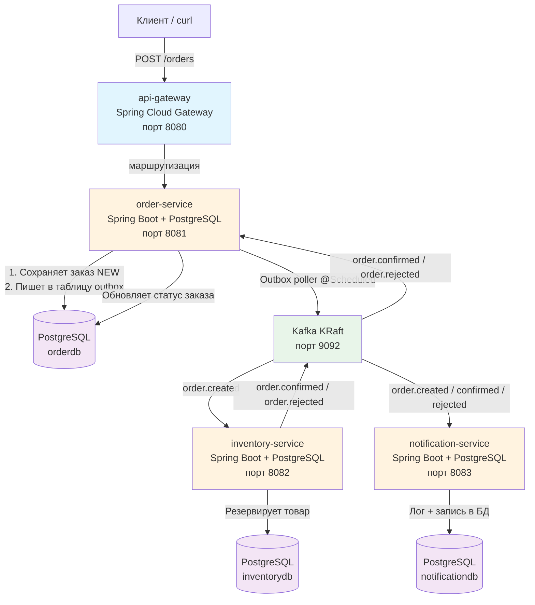

# OrderHub

Образовательная микросервисная система приёма и обработки заказов. Демонстрационный артефакт для собеседований Java middle+.

## 🎯 Зачем этот проект

Закрывает перерыв в резюме живым артефактом вместо строчки «изучал Kafka». Демонстрирует стек, заявленный в резюме: **Spring Boot 3.x, Kafka, микросервисы, Spring Cloud Gateway, PostgreSQL, Docker, CI**. Даёт материал для ответов на собеседовании про Kafka, идемпотентность, отказоустойчивость и транзакционный outbox — с примерами из реального кода.

## 📐 Архитектура



### Компоненты

| Компонент | Ответственность | Стек |
|-----------|----------------|------|
| `api-gateway` | Маршрутизация запросов на `order-service` и `inventory-service`. Никакой бизнес-логики. | Spring Cloud Gateway |
| `order-service` | Приём заказов, валидация, хранение в PostgreSQL, публикация событий в Kafka через Transactional Outbox, чтение подтверждений/отказов. | Spring Boot 3.x, Spring Data JPA, Flyway, spring-kafka |
| `inventory-service` | Резервирование товара в своей базе, публикация `OrderConfirmed` / `OrderRejected`. | Spring Boot 3.x, Spring Data JPA, Flyway, spring-kafka |
| `notification-service` | Запись уведомлений о событиях в лог и таблицу PostgreSQL. | Spring Boot 3.x, Spring Data JPA, Flyway, spring-kafka |

### Сценарий работы

1. Клиент отправляет `POST /orders` через Gateway.
2. `order-service` сохраняет заказ со статусом `NEW` и пишет событие `OrderCreated` в таблицу `outbox` в **той же транзакции**.
3. Outbox poller (`@Scheduled`) читает неопубликованные события и шлёт в топик Kafka `order.created`.
4. `inventory-service` читает `order.created`, проверяет идемпотентность (таблица `processed_events`), резервирует товар и шлёт `order.confirmed` или `order.rejected` в Kafka.
5. `order-service` читает подтверждение/отказ и переводит заказ в `CONFIRMED` / `REJECTED`.
6. `notification-service` читает все события и записывает уведомление в лог + БД.
7. Статус заказа можно посмотреть через `GET /orders/{id}`.

## 🛠 Стек

| Компонент | Версия |
|-----------|--------|
| Java | 21 |
| Spring Boot | 3.2.5 |
| Spring Cloud | 2023.0.1 |
| Apache Kafka | 3.9.0 (KRaft) |
| PostgreSQL | 15 |
| Flyway | последняя |
| Spring Data JPA | — |
| spring-kafka | — |
| springdoc-openapi | 2.5.0 |
| Actuator + Micrometer | — |
| Docker / Docker Compose | — |
| GitHub Actions | — |
| JUnit 5, Mockito | — |
| Testcontainers | — |

**Почему Spring Data JPA:** для pet-проекта достаточно простоты и скорости разработки. JPA скрывает boilerplate SQL, а Flyway отвечает за миграции схемы.

## 🚀 Быстрый старт

### Предварительные требования
- Docker и Docker Compose
- Java 21 (для локальной сборки)

### 1. Клонировать репозиторий

```bash
git clone https://github.com/Dm-prog/order_hub.git
cd order_hub
```

### 2. Запустить инфраструктуру

```bash
docker compose up -d
```

Это поднимет:
- 3 экземпляра PostgreSQL (orderdb, inventorydb, notificationdb)
- Kafka (KRaft) на порту 9092

### 3. Собрать и запустить сервисы

```bash
mvn -q -DskipTests package

java -jar order-service/target/order-service-1.0.0.jar &
java -jar inventory-service/target/inventory-service-1.0.0.jar &
java -jar notification-service/target/notification-service-1.0.0.jar &
java -jar api-gateway/target/api-gateway-1.0.0.jar &
```

Или запускать каждый модуль из IDE.

### 4. Примеры curl-запросов

**Создать заказ:**
```bash
curl -X POST http://localhost:8080/orders \
  -H "Content-Type: application/json" \
  -H "X-Correlation-Id: my-correlation-123" \
  -d '{
    "orderNumber": "ORD-001",
    "customerName": "Иван Иванов",
    "customerEmail": "ivan@example.com",
    "totalAmount": 1500.00
  }'
```

**Получить заказ по ID:**
```bash
curl http://localhost:8080/orders/1
```

**Отменить заказ (только со статусом NEW):**
```bash
curl -X DELETE http://localhost:8080/orders/1
```

**Проверить Swagger UI:**
```
http://localhost:8081/swagger-ui.html      # order-service
http://localhost:8082/swagger-ui.html      # inventory-service
http://localhost:8083/swagger-ui.html      # notification-service
```

**Проверить Actuator health:**
```bash
curl http://localhost:8081/actuator/health
curl http://localhost:8081/actuator/prometheus
```

## 🔄 Стратегия развертывания

Проект разворачивается через **Docker Compose** — один файл для всей инфраструктуры:

```
docker-compose.yml
├── postgres-order:5432      → order-service
├── postgres-inventory:5433  → inventory-service
├── postgres-notification:5434 → notification-service
└── kafka:9092 (KRaft)       → все сервисы
```

**Порядок запуска:**
1. `docker compose up -d` — поднимает инфраструктуру
2. Собрать сервисы: `mvn package`
3. Запустить сервисы в любом порядке (они подключаются к Kafka и БД при старте)
4. Проверить health: `curl http://localhost:8081/actuator/health`

**Переменные окружения** передаются через `application.yml` со значениями по умолчанию для локальной разработки. На продакшене их можно переопределить через `.env` или переменные окружения Docker.

## 🛡 Обработка ошибок

### Единый формат ошибок

Все сервисы используют `@RestControllerAdvice` с единым форматом ответа:

```json
{
  "status": 400,
  "error": "Bad Request",
  "message": "Order with number ORD-001 already exists",
  "timestamp": "2024-01-15T10:30:00",
  "errors": {
    "field": "validation message"
  }
}
```

### HTTP-коды

| Код | Значение | Когда используется |
|-----|----------|-------------------|
| 200 | OK | Успешный GET |
| 201 | Created | Успешное создание заказа |
| 204 | No Content | Успешная отмена заказа |
| 400 | Bad Request | Ошибка валидации, неверные входные данные |
| 404 | Not Found | Заказ не найден |
| 409 | Conflict | Невозможно отменить (неверный статус), дубликат |
| 500 | Internal Server Error | Внутренняя ошибка сервера |

### Дерево исключений

- `IllegalArgumentException` → 400 Bad Request (бизнес-ошибки, дубликаты, неверные данные)
- `IllegalStateException` → 409 Conflict (нельзя отменить заказ не в статусе NEW)
- `MethodArgumentNotValidException` → 400 Bad Request (ошибки валидации `@Valid`)
- `Exception` (generic) → 500 Internal Server Error (непредвиденные ошибки)

## 📌 Версионирование API

Следует стратегии **версионирования через путь URL**:

```
GET  /api/v1/orders/{id}
POST /api/v1/orders
```

**Правила версионирования:**
- Мажорная версия (v1) в пути — ломающие изменения требуют новой версии
- Минорные изменения (добавление полей, эндпоинтов) — внутри той же версии без изменения пути
- Депрекейт старых версий с заголовком `Deprecation` и сроком жизни

Текущая реализация использует базовые пути без явного префикса `/api/v1/` для упрощения pet-проекта, но структура контроллеров готова к добавлению префикса.

## 🧹 Очистка данных

### Очистка обработанных outbox-событий

Таблица `outbox` растёт с каждым опубликованным событием. В текущей реализации есть два подхода к очистке:

1. **Логическое удаление:** после успешной публикации поле `published_at` заполняется. Запись не удаляется физически, но помечается как обработанная.
2. **Физическая очистка (планируется):** `@Scheduled` задача, которая удаляет записи старше N дней (например, 30 дней) с `published_at IS NOT NULL`.

```sql
DELETE FROM outbox
WHERE published_at IS NOT NULL
  AND created_at < NOW() - INTERVAL '30 days';
```

### Очистка старых processed_events

Таблица `processed_events` используется для идемпотентности. Стратегия очистки:

- **TTL 7-30 дней** — события старше TTL можно безопасно удалить, так как вероятность повторной доставки такого старого сообщения ничтожна
- Физическое удаление по `processed_at < NOW() - INTERVAL '7 days'`

### Стратегия обработки коллизий идемпотентности

Если приходит дубликат события с тем же `(topic, event_key)`:
1. Консьюмер проверяет `existsByTopicAndEventKey()` перед обработкой
2. Если запись существует — событие пропускается, лог `INFO` с пометкой "already processed"
3. Если не существует — обрабатывается и записывается в `processed_events`

Коллизия по `event_key` обрабатывается через уникальный индекс `uk_processed_events(topic, event_key)` — вторая попытка вставки упадет с ошибкой уникальности, которая обрабатывается как "уже обработано".

## 🔁 Политики повтора (Retry)

Кafka консьюмеры используют `DefaultErrorHandler` + `DeadLetterPublishingRecoverer`:

| Параметр | Значение | Обоснование |
|----------|----------|-------------|
| Максимум попыток | 3 | Достаточно для временных сбоев (сеть, БД) |
| Интервал между попытками | 1 секунда (FixedBackOff) | Быстрое восстановление для pet-проекта |
| Стратегия backoff | Фиксированная | Простота и предсказуемость |
| DLQ топик | `<оригинальный-топик>.dlq` | Чёткая привязка к источнику |

**Почему не экспоненциальная задержка:** для pet-проекта фиксированный интервал проще в понимании и отладке. На продакшене можно перейти на `ExponentialBackOff`.

## 💀 Обработка DLQ (Dead Letter Queue)

Сообщения, исчерпавшие все попытки retry, попадают в DLQ топик.

**Стратегия работы с DLQ:**

1. **Мониторинг:** отслеживать размер DLQ топиков через Actuator или Kafka tools
2. **Анализ:** читать сообщения из DLQ, определять причину ошибки (сериализация, недоступность БД, бизнес-логика)
3. **Повторная отправка:** после исправления причины — отправить сообщение обратно в исходный топик
4. **Ручная обработка:** для бизнес-ошибок — корректировать данные вручную через API или БД

Пример просмотра DLQ:
```bash
docker exec -it kafka kafka-console-consumer.sh \
  --bootstrap-server localhost:9092 \
  --topic order.created.dlq \
  --from-beginning
```

## 📊 Метрики

Actuator + Micrometer предоставляют следующие метрики:

| Метрика | Описание | Как использовать |
|---------|----------|-----------------|
| `http.server.requests` | Количество HTTP-запросов | Мониторинг нагрузки на API |
| `jvm.memory.used` | Использование памяти JVM | Detect утечек памяти |
| `system.cpu.usage` | Загрузка CPU | Detect перегрузки |
| `kafka.consumer.lag` | Lag консьюмера | Задержка обработки событий |
| `process.uptime` | Время работы приложения | Доступность сервиса |

**Эндпоинты:**
- `GET /actuator/metrics` — список всех метрик
- `GET /actuator/metrics/{metric.name}` — значение конкретной метрики
- `GET /actuator/prometheus` — экспорт в формате Prometheus

**Где смотреть:**
- Локально: `http://localhost:8081/actuator/prometheus`
- На продакшене: подключить Prometheus к этому эндпоинту

## 📝 Стратегия логирования

Все сервисы используют **SLF4J + Logback** (через Spring Boot starter).

### Формат логов

```
%d{yyyy-MM-dd HH:mm:ss.SSS} [%X{X-Correlation-Id:-}] %-5level %logger{36} - %msg%n
```

| Часть | Значение |
|-------|----------|
| `%d` | Дата и время события |
| `%X{X-Correlation-Id}` | Correlation ID из MDC (или `-` если нет) |
| `%-5level` | Уровень логирования (INFO, WARN, ERROR) |
| `%logger{36}` | Имя класса-логирователя |
| `%msg` | Сообщение |

### Уровни логирования

| Уровень | Когда используется |
|---------|-------------------|
| `INFO` | Бизнес-события: создание заказа, подтверждение, отказ, отправка уведомления |
| `WARN` | Предупреждения: товар недоступен, событие уже обработано (дубль) |
| `ERROR` | Ошибки: не удалось отправить в Kafka, ошибка БД, не удалось обработать событие |
| `DEBUG` | Отладочная информация (отключена по умолчанию) |

### Что логируется

- Все входящие HTTP-запросы с `X-Correlation-Id`
- Создание/подтверждение/отмена заказов
- Отправка и получение Kafka-событий
- Ошибки с полным стектрейсом
- События идемпотентности (дубликаты)

## 🚢 Процесс деплоя

### Локальная разработка

```bash
# 1. Инфраструктура
docker compose up -d

# 2. Сборка
mvn -q -DskipTests package

# 3. Запуск сервисов
java -jar order-service/target/*.jar &
java -jar inventory-service/target/*.jar &
java -jar notification-service/target/*.jar &
java -jar api-gateway/target/*.jar &

# 4. Проверка
curl http://localhost:8081/actuator/health
```

### Продакшен (рекомендации)

1. Собрать Docker-образы для каждого сервиса (`Dockerfile` для каждого модуля)
2. Развернуть через Kubernetes или Docker Swarm
3. Настроить centralized logging (ELK stack)
4. Настроить мониторинг (Prometheus + Grafana)
5. Настроить алерты на критичные метрики

## 🧪 Тестирование

### Покрытие тестами

| Тип теста | Инструмент | Что покрыто | Статус |
|-----------|------------|-------------|--------|
| Юнит-тесты | JUnit 5 + Mockito | Бизнес-логика `order-service` (8 тестов), `inventory-service` (3 теста) | ✅ Зеленые |
| Интеграционные | Testcontainers | Сквозной сценарий с реальной PostgreSQL и Kafka | ⚠️ Требует Docker (`@Disabled`) |

**Что покрыто тестами:**
- Создание заказа с валидацией
- Отказ при дубликате orderNumber
- Получение заказа по ID (найден / не найден)
- Отмена заказа (NEW → CANCELLED, ошибка если не NEW)
- Подтверждение и отклонение заказа
- Резервирование товара (достаточно / недостаточно)
- Освобождение резерва

**Что не покрыто:**
- Scвозной e2e сценарий через Kafka (требует Docker)
- Обработка ошибок Kafka (retry, DLQ)
- Контроллеры API (через интеграционные тесты, требующие Docker)

Запуск юнит-тестов:
```bash
mvn test
```

## 🚨 Алерты

Рекомендуемые алерты для мониторинга:

| Алерт | Условие | Критичность |
|-------|---------|-------------|
| DLQ не пуст | Размер любого `*.dlq` топика > 0 | High — сообщения теряются |
| Lag консьюмера | Consumer lag > 1000 сообщений | Medium — задержка обработки |
| Сервис недоступен | Actuator health != UP | High — инцидент |
| Ошибки приложения | Количество ошибок в логах > threshold | Medium — деградация |
| Подключение к БД потеряно | Spring unable to connect to PostgreSQL | Critical |

## ⚠ Узкие места и проблемы текущей реализации

| Проблема | Описание | Как решить |
|----------|----------|------------|
| Нет физической очистки outbox | Таблица растёт бесконечно | Добавить `@Scheduled` задачу удаления старых записей |
| Нет физической очистки processed_events | Таблица растёт бесконечно | Добавить TTL через `@Scheduled` задачу |
| Нет версионирования API | Пути без `/api/v1/` | Добавить префикс версии в контроллеры |
| Нет аутентификации | Любой может создавать заказы | Добавить Spring Security + JWT/OAuth2 |
| Нет rate limiting на уровне сервисов | Gateway имеет базовый rate limit | Добавить Resilience4j или Bucket4j |
| Нет горизонтального масштабирования | Один инстанс на сервис | Kubernetes с несколькими репликами |
| Testcontainers требуют Docker | Интеграционные тесты `@Disabled` | Настроить Docker в CI/CD для прогона тестов |

## ❓ Ответы на типичные вопросы собеседования

### Почему выбран именно такой подход к outbox?

**Ответ:** Обычный подход "сохранить в БД → отправить в Kafka" не атомарен. Если Kafka недоступна после сохранения заказа, мы теряем событие. Transactional Outbox решает эту проблему: событие пишется в ту же транзакцию, что и заказ. Отдельный poller гарантирует доставку в Kafka. Это pattern для распределённых систем, где нужна согласованность без distributed transactions (2PC).

### Как обеспечивается идемпотентность?

**Ответ:** Через таблицу `processed_events` с уникальным индексом на `(topic, event_key)`. Перед обработкой каждого Kafka-сообщения консьюмер проверяет, не обработано ли уже сообщение с таким ключом. Если обработано — пропускает. Если нет — обрабатывает и пишет в таблицу. Уникальный индекс защищает от гонок (race conditions) при параллельной обработке.

### Какие есть проблемы с текущей реализацией?

**Ответ:**
1. Нет очистки старых outbox и processed_events записей — таблицы растут бесконечно
2. Нет версионирования API
3. Нет аутентификации и авторизации
4. Интеграционные тесты требуют Docker и отключены в этой среде
5. Нет горизонтального масштабирования консьюмеров

### Как бы вы улучшили систему?

**Ответ:**
1. Добавить `@Scheduled` очистку старых записей (TTL 30 дней для outbox, 7 дней для processed_events)
2. Добавить Spring Security с JWT для аутентификации
3. Добавить версионирование API (`/api/v1/`)
4. Добавить интеграционные тесты в CI с Testcontainers + Docker
5. Добавить Prometheus + Grafana дашборд с метриками lag консьюмеров и ошибок DLQ
6. Рассмотреть Saga для компенсации (отмена заказа после подтверждения)

### Какие есть узкие места?

**Ответ:**
1. **Outbox poller** — однопоточный, может стать бутылочным горлышком при высокой нагрузке. Решение: partitioned polling или несколько инстансов с блокировкой записей.
2. **Одна база на сервис** — ограничивает масштабирование чтения. Решение: read replicas.
3. **Один консьюмер на группу** — последовательная обработка. Решение: увеличить количество партиций и консьюмеров в группе.

## 🔒 Стратегия безопасности

В текущей реализации безопасность не реализована (умышленно, для упрощения pet-проекта). Рекомендуемые меры:

| Мера | Описание |
|------|----------|
| Аутентификация | Spring Security + JWT или OAuth2 |
| Авторизация | Role-based access control (ADMIN, USER) |
| CORS | Настройка разрешенных источников в Gateway |
| Rate limiting | Bucket4j или Resilience4j на уровне Gateway |
| Секреты | Переменные окружения, Docker Secrets или HashiCorp Vault |
| HTTPS | Терминация на Ingress или Load Balancer |

## 📈 План масштабирования

| Компонент | Стратегия масштабирования |
|-----------|--------------------------|
| `order-service` | Горизонтальное масштабирование (несколько инстансов), общая база данных |
| `inventory-service` | Горизонтальное масштабирование консьюмеров Kafka (больше партиций) |
| `notification-service` | Горизонтальное масштабирование (stateless сервис) |
| PostgreSQL | Read replicas для чтения, шардирование при необходимости |
| Kafka | Увеличение количества партиций, репликация (3+) |

## 🗺 План развития проекта

| Итерация | Что добавить |
|----------|-------------|
| 1 | Очистка старых outbox/processed_events (@Scheduled) |
| 2 | Spring Security + JWT аутентификация |
| 3 | Версионирование API (`/api/v1/`) |
| 4 | Интеграционные тесты в CI с Testcontainers |
| 5 | Prometheus + Grafana дашборд |
| 6 | Saga с компенсацией (отмена после подтверждения) |
| 7 | Kubernetes манифесты / Helm чарт |

## ✅ Чек-лист готовности

- [x] `docker compose up` — инфраструктура поднимается одной командой
- [x] REST CRUD заказов работает через Gateway
- [x] События публикуются в Kafka через Transactional Outbox
- [x] Консьюмеры обрабатывают события с идемпотентностью
- [x] Retry + DLQ настроены для Kafka консьюмеров
- [x] Swagger UI доступен для всех сервисов
- [x] Actuator health/metrics работают
- [x] Correlation ID передаётся по цепочке
- [x] Юнит-тесты проходят (11/11)
- [x] GitHub Actions CI настроен
- [x] README с диаграммой и архитектурными решениями
- [x] Ответы на типичные вопросы собеседования

## 👤 Автор

Дмитрий Котов — Java разработчик. Проект создан как Демонстрационный артефакт для собеседований middle+.